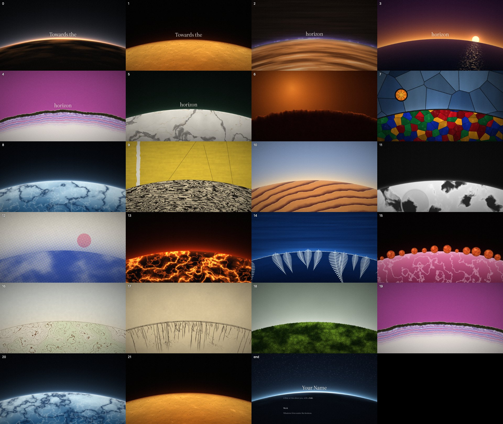

# horizon-frames

A Claude Code skill for film-style website intros. One curved planet horizon is rendered in
a different material each cut, in a single WebGL shader: honey, geode, ice, halftone print,
lava, ink. The cuts get faster and faster, from 1.5 s down to a single frame, and the last
cut holds on a starry end card with your name on the horizon. The page fades in below it.



*All 22 frames in the template, and the end card.*

It was inspired by the visual language of Anthropic's Claude Opus 5.5 launch film. It has no
affiliation with Anthropic.

## Install

```bash
git clone https://github.com/Zxch-Chen/horizon-frames ~/.claude/skills/horizon-frames
```

Then ask Claude Code something like:

- "Make me a horizon-frames intro for my site."
- "Add three new horizon frames: cyanotype, stained glass, and coral."
- "Use my photo `sunset.jpg` as a frame."
- "Record the intro as a video I can post."

## What's inside

| File | What it is |
|---|---|
| `SKILL.md` | The instructions Claude follows: the look, the shader contract, how to add and check frames, and past mistakes. |
| `template/horizon.html` | A complete, self-contained intro page with 19 materials. Open it over http. |
| `scripts/shoot.mjs` | Screenshots frames, catches shader compile errors, and tiles a contact sheet. |
| `scripts/record.mjs` | Records the intro to a 1080p, 60 fps MP4 frame by frame, so no cut is dropped. |

## Try the template without Claude

```bash
cd template && python3 -m http.server 8765
```

Open http://localhost:8765/horizon.html. Add `?frame=7` to hold one frame, or `?intro=1` to replay the intro.

## License

MIT. See [LICENSE](LICENSE).
